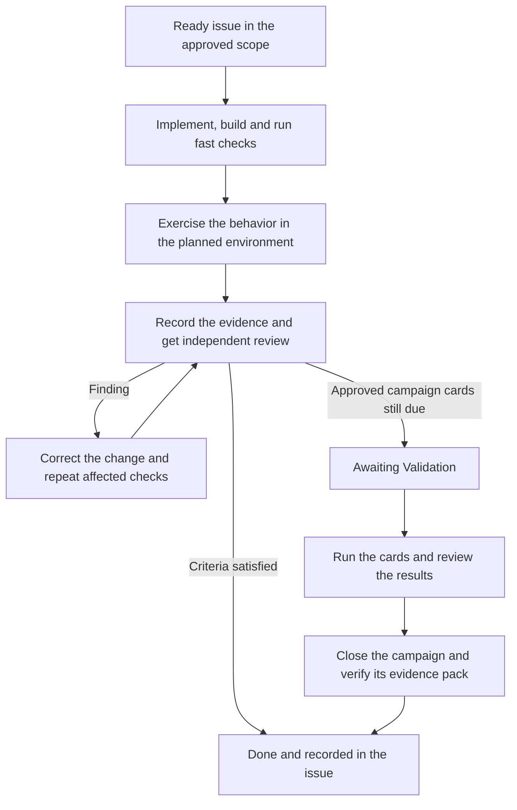
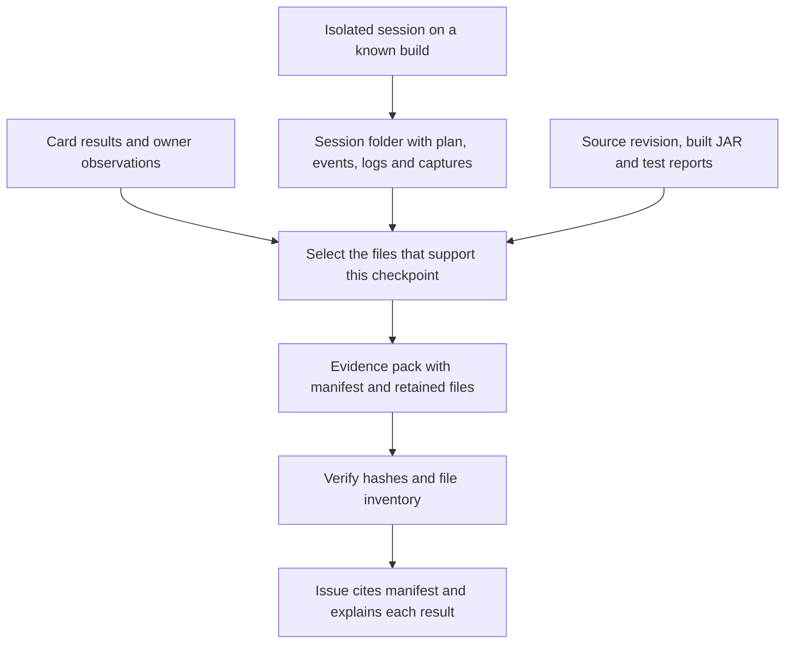

# How Implementation works

If you are coming back to a mod after a break, open **`workspace/documentation/project-status.md`**. It tells you which workflow is active, what happens next, and whether anything needs your decision. Follow its pointer to the current issue. The issue's **Status** and **Completion Evidence** tell you what has actually been built and checked. The shorter `project-state.md` is a handoff summary.

This is a reader's guide to Minecraft 1.12.2 Implementation. The linked stage, procedures, and tool manuals own the operating instructions.

- [Follow an issue from plan to completion](#what-happens-to-an-issue)
- [See where Minecraft runs](#where-do-the-tests-run)
- [Understand when another instance is created](#when-does-another-instance-get-created)
- [Know what happens during a test session](#what-happens-during-a-session)
- [Find the evidence for a result](#how-do-i-trace-a-result-back-to-the-build)
- [Understand what happens after testing](#what-happens-to-the-files-after-testing)

## What happens to an issue?

Suppose your mod displays damage numbers. “Make critical hits readable” leaves a lot to judgment. A useful issue identifies what you should see, for example a number that starts larger on a confirmed critical hit and settles back to its normal size. That gives the agent something it can measure and gives you a specific animation to judge during play.

The Implementation Plan identifies the issue, its dependencies, its acceptance criteria and the checks that can establish them. The approved scope and review cadence determine which issues the agent can work through before checking in with you. Most implementation issues take this route. [Implementation Plan](../stages/6-implementation-plan.md) · [Issue execution](../stages/7-implementation.md#issue-execution-process)



**Awaiting Validation** explains why you might see several implemented features queued for one play session. The issues have passed their non-campaign checks and pre-campaign review. The plan groups the remaining owner observations so you can judge related features in one prepared scene. A **Blocked** issue has a specific unmet prerequisite. The issue file gives the reason. [Issue statuses](../stages/6-implementation-plan.md#issue-statuses) · [Owner-assisted campaigns](../stages/7-implementation.md#owner-assisted-validation-campaigns)

## Where do the tests run?

The question being tested determines the environment. For the damage number, a rounding test can finish without opening Minecraft. A screenshot needs a rendering client. Checking who received a private hit needs distinct connections. The plan uses six tiers to make the scope of each result explicit. [Verification environment plan](../stages/6-implementation-plan.md#verification-environment-plan)

| Tier | Environment | Example question |
| --- | --- | --- |
| 1 | Automated test or static inspection | Does a known damage value produce the expected label? Does the built JAR contain the declared metadata? |
| 2 | Forge development client, including its integrated server | Does the number appear at the right position in a world? |
| 3 | Forge development dedicated server | Can the server start with the change, process a hit, and select its recipient? |
| 4 | Built mod JAR in the selected packaged test instance | Does the packaged build load and draw the number with these exact dependencies? |
| 5 | Built JAR in the target modpack, usually in a disposable copy | Does the number remain readable with the pack's renderer and settings? |
| 6 | Separately operated multiplayer environment | During the same hit, what does each connected participant receive and see? |

There are two common ways to run a packaged test. With an **isolated runtime**, the agent can launch the approved client or server directly through Java. With a **shared launcher instance**, the agent checks ownership, snapshots its baseline and stages the approved files. Launch ownership comes from Project Setup, and the borrowed instance is reset after the campaign. An owner pack can also supply read-only inputs for an isolated run. A result from a small profile covers the interactions actually exercised there. [Test instance choices](../guidelines/project-defaults.md#test-instance)

## When does another instance get created?

An **installation** is the directory on disk. A **launch** starts a client or server process. A **session** is a finite plan that can start, stop and restart those processes. A **campaign** groups checks and can span several sessions or installations. Ten cards can use one installation. One persistence card can require two launches of the same server.

For a new isolated installation, `prepare` reads a project-owned profile naming the Java executable, loader, cached Minecraft files, side-specific mod JARs, and selected configs or scripts. It checks the pins, copies the runtime inputs into `workspace/runtime/<name>/`, and creates separate client and server game directories. It writes the prepared profile, a runtime manifest and launch arguments. Java runs from its pinned installation. Each fresh root has its own copied base, which is why repeated preparation costs disk space. [Runtime preparation and profile fields](../tools/cleanroom-runtime/README.md#prepare-a-profile)

Here is what you would see in an isolated installation named `numbers` after two sessions. The directory names under `evidence/` are abbreviated.

```text
workspace/runtime/numbers/
  profile.json          Inputs selected for this installation
  runtime.json          Installed inventory and expected hashes
  client.args           Client launch arguments
  server.args           Dedicated-server launch arguments
  assets/               Copied Minecraft assets
  libraries/            Copied runtime libraries
  client/               Client mods, settings and single-player saves
  server/               Server mods, settings and dedicated world
  evidence/
    <first-session>/    First plan, launches and results
    <second-session>/   Second plan, launches and results
```

| What changed since the last trial? | What happens on disk and in the game? |
| --- | --- |
| Another card uses the same build and inputs | Reuse the installation. Reset the relevant scene, player state or settings. A new session gets its own evidence directory. |
| A setting changes through a supported in-game control | Apply it, confirm its effect and repeat the observation. If the question concerns startup, restart with that setting selected. |
| Only the project JAR was rebuilt | Stop the installation and refresh it when the filename, installed sides and embedded dependencies still match and the starting state can be restored. The tool checks the old inventory and the new hash, retains the prior JAR and metadata, and installs the candidate on its prepared sides. The next session launches the new code. |
| The test needs first-launch defaults, a different dependency or fixture, or state that cannot be reliably reset | Prepare a fresh named root. An unexpected inventory change warrants investigation. An interrupted refresh leaves an incomplete installation that refuses launches. |
| Two viewers must observe the same event | Use two concurrent clients with distinct identities and game directories on the same server. The standard isolated session owns at most one client and one server. The plan identifies the approved arrangement for the second viewer. |

**Example.** Two packaged builds change the size and then the motion of the number under one renderer. They can share one installation through a verified refresh. Keep the camera, target, hit and capture timing consistent across builds. Switching between already installed shaders can exercise live switching in that client. Checking shader startup requires another launch. Adding a renderer mod changes the profile and calls for a fresh installation. In a privacy test, record the real hit and both viewers' traffic. A fixture that simply draws a number can answer a rendering question but cannot establish server delivery. [Isolated validation procedure](../procedures/isolated-cleanroom-validation.md#preparation) · [JAR refresh](../tools/cleanroom-runtime/README.md#refresh-the-project-jar)

## What happens during a session?

Before a campaign, the **session map** connects each criterion to a test card, starting state and distinguishing observation. A **fixture** supplies controlled inputs, such as a mob with known health. A **bundle** is a saved sequence of Toolkit commands that can set up or repeat a scene. The agent smoke-tests new scene bundles in the intended environments. A hit that never lands would make the subsequent screenshot useless.

In an isolated session, the runner takes the installation lock, verifies the inputs, starts the requested processes and waits for fresh readiness signals. The plan can send server commands, request Toolkit actions, capture a screenshot, reconnect, or exercise a real stop and start. For a persistence check it carries the same world across that restart. Ordinary completion includes graceful shutdown. A crash or forced cleanup leaves a failed or incomplete attempt with evidence for diagnosis. [Session actions and ownership](../tools/cleanroom-runtime/README.md#run-a-session)

**What do you have to do?** For an owner-assisted campaign, you see the planned checks up front and usually receive one actionable card at a time. You might be asked whether two numbers are distinguishable during combat. The agent can inspect the recorded values and timing itself. If a card fails, the failed attempt stays on record. An affected check runs again on the identified correction, and the reviewer can trace which build produced each result. [Manual validation](../guidelines/manual-validation.md) · [Campaign closure](../procedures/close-campaign.md)

## How do I trace a result back to the build?

Start at the **issue** for the claim, follow its **manifest reference** for the exact build and retained files, then open the **log, screenshot or card result** for the observation. This works even after the original installation has been retired, provided the referenced evidence has been retained.



| If you want to know… | Where to look in your local workspace |
| --- | --- |
| What is active? What needs my decision? | `workspace/documentation/project-status.md`. For a quick handoff, read `project-state.md` alongside it. |
| What was promised and how was it checked? | `implementation-plan.md` and `issues/` under the active documentation root. For initial development this is `workspace/documentation/`. For a change cycle it is `workspace/documentation/cycles/<cycle-id>/`. |
| What was installed? | `workspace/runtime/<name>/runtime.json` records the inventory and pins. `profile.json` describes preparation. A session keeps copies of both. After a refresh, `evidence/refresh-*/` holds the change record and previous build. |
| What actually happened in one isolated session? | `workspace/runtime/<name>/evidence/<session-id>/`. Start with `result.json`, then `plan.json` and `events.json`. Per-launch folders contain `console.log` and before/after snapshots. After an abrupt interruption the final result file may be missing. |
| Which settings or scene produced this image? | Inspect the launch snapshots and the files explicitly retained for that check. Worlds live in the game directory. Shader-pack selection, pack-specific options and replay inputs may need separate capture. A preparation profile alone cannot reconstruct every in-game change. |
| What did the owner see? | The campaign session map names its results file. Match the card ID to the result, observation and supporting capture. |
| What survived as checkpoint evidence? | Open the manifest named by the issue. A typical issue pack is `workspace/validation/implementation/<issue>/<checkpoint>/manifest.json`. Campaign manifests are at `workspace/validation/campaigns/<campaign>/manifest.json`. |

A pack is a directory containing the selected files, a summary and a manifest. The manifest records Git commit and tree, file paths, byte sizes and SHA-256 hashes. When earlier launches supplied some evidence, `runtimeSources` identifies the source those launches actually used. The pack tool verifies file identity. The issue explains what those files establish. Simple issues with one stable check can cite it directly. When retained evidence changes after capture, a replacement pack gets a new directory and the issue points to it. [Evidence-pack routing](../stages/7-implementation.md#evidence-pack-routing) · [Pack contents and verification](../tools/evidence-pack/README.md)

**How strong is a claim?** “I saw the critical number settle during play” is **observed**. “The retained JAR contains the expected metadata” is **inspected**. “The number should behave the same with another renderer” is **inferred**. That last claim needs a check on the other renderer or an owner-accepted limitation before it can close a criterion. [Evidence labels](../stages/7-implementation.md#evidence-labels)

## What happens to the files after testing?

At campaign close, the agent reconciles card results, resolves follow-up review findings, records the completion revision, captures and verifies the campaign pack, and updates the included issues and project ledger. A borrowed instance is restored to its baseline. A project-owned isolated installation can serve another compatible trial while its state and evidence remain attributable. [Closing a campaign](../procedures/close-campaign.md)

Implementation ends with the release-scoped issues complete, the required checks accounted for, and your approval to proceed. Release Presentation owns the final distributable and handoff. When you are ready to upload, `release-handoff.md` identifies the approved JAR in the mod repository's `build/libs/`. [Stage completion](../stages/7-implementation.md#stage-completion-criteria) · [Release Presentation](../stages/8-release-presentation.md)

### Workflow Closure

After the last applicable stage, the agent brings you the baseline or cycle summary, the retrospective, and the cleanup outcome. You can approve closure while keeping the test files for a pending reproduction or deciding about cleanup later. Look in `project-status.md` for the **Validation cleanup** field and its supporting record. The final handoff gives you the publication packet for a release or the approved wording and commit for a copy-only correction. [Workflow Closure](../procedures/workflow-closure.md)

When cleanup is proposed, you see the exact paths before deciding. An isolated installation can be retired once the needed evidence and replay inputs have verified recovery sources. To see whether reuse helped, compare **peak allocated disk space during testing** and **time from JAR ready to the first usable result**. The size left after cleanup answers a different question. [Validation cleanup and recovery](../procedures/cleanup-validation-workspace.md)
